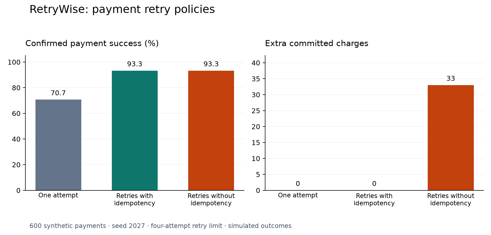

# RetryWise

A Python simulation of payment retries, focused on the case where a charge succeeds but its response is lost. It compares confirmed success, duplicate charges, request volume, and completion time across three retry policies.

Built with Python, pandas, and matplotlib. All transactions are synthetic; the project does not connect to a payment provider.

## Results

The default run uses the same 600 payments and scripted responses for each policy, with random seed `2027`.

| Policy | Confirmed success | Duplicate charges | Requests | p95 simulated time |
|---|---:|---:|---:|---:|
| One attempt | 70.7% | 0 | 600 | 45.0 ms |
| Retries with idempotency | 93.3% | 0 | 760 | 172.2 ms |
| Retries without idempotency | 93.3% | 33 | 761 | 173.5 ms |



In this simulation, retries increase confirmed success by **22.6 percentage points**. A stable idempotency key prevents the duplicate charges seen when retrying without that protection. The gain costs additional requests and waiting time. These figures describe this synthetic dataset, not expected production performance.

## How it works

Each payment has an amount in integer cents and a predefined sequence of service responses. Temporary failures include rate limits, server errors, and timeouts. Card declines stop immediately.

The retry policy allows four total attempts. Before each retry, it samples a delay between zero and `min(100 × 2^(attempt − 1), 1000)` milliseconds. Each request adds 45 ms of simulated processing time. The simulator advances a counter rather than sleeping.

The service records charges separately from responses. If a request charges successfully and then times out, replaying the same idempotency key returns the stored result. Reusing a key with a different amount produces a conflict.

## Run locally

Use Python 3.12. From this directory:

```bash
python3.12 -m venv .venv
source .venv/bin/activate
python -m pip install -r requirements.txt
python run_simulation.py
python -m unittest discover -s tests -v
```

The simulation writes `results/summary.csv` and `results/policy_comparison.png`. It can run without opening Jupyter or displaying a window. Direct dependency versions are pinned; the complete transitive environment is not locked.

To explore the notebook in VS Code, install kernel support in the same environment and select it as the notebook kernel:

```bash
python -m pip install ipykernel
```

Open `RetryWise_Payment_Retry_Simulator.ipynb` and run its cells in order. It includes an additional comparison of fixed backoff and jitter, plus per-attempt logs. The notebook installs no packages automatically.

## Tests

Six behavior tests cover:

- Retrying a timeout after a charge without charging again.
- The duplicate-charge risk when idempotency is disabled.
- Stopping immediately after a card decline.
- Enforcing the attempt limit and recording exhaustion.
- Reproducible jitter within its delay bounds.
- Replaying a key and rejecting an amount conflict.

These tests run with Python's built-in `unittest` runner. The notebook also contains the original assertions for interactive use.

## Files

| File | Purpose |
|---|---|
| `simulator.py` | Payment scenarios, service model, retry policies, and metrics |
| `run_simulation.py` | Command-line comparison and chart export |
| `tests/test_simulator.py` | Runnable behavior tests |
| `RetryWise_Payment_Retry_Simulator.ipynb` | Walkthrough and experiments |
| `results/` | Default-run summary and comparison figure |

The module and notebook currently contain the same simulation logic. Changes to that logic should be reflected in both.

## Limits and next steps

This is a sequential, in-memory simulator with scripted responses. It does not model concurrency, persistent idempotency records, key expiry, real network timing, or provider-specific rules. Because response scripts do not depend on request timing, this experiment does not demonstrate jitter reducing congestion.

A natural next step is a small API with SQLite-backed idempotency and a concurrent-request test that verifies one committed charge per logical payment.
